# CyberShield — ER Diagram

Rendered automatically by GitHub, IntelliJ IDEA (Markdown preview with Mermaid enabled) and https://mermaid.live.
Only the key attributes are shown; see `database-design.md` and the Flyway migrations for every column.

```mermaid
erDiagram
    ROLES ||--o{ USERS : "has (1 role per user)"
    DEPARTMENTS |o--o{ USERS : "employs"
    DEPARTMENTS ||--o{ ASSETS : "owns"
    OFFICE_LOCATIONS ||--o{ ASSETS : "hosts"
    USERS |o--o{ ASSETS : "asset owner"

    ASSETS ||--o{ ASSET_SOFTWARE : "has installed"
    SOFTWARE ||--o{ ASSET_SOFTWARE : "installed on"

    ASSETS ||--o{ ASSET_VULNERABILITIES : "affected by"
    VULNERABILITIES ||--o{ ASSET_VULNERABILITIES : "affects"

    ASSET_VULNERABILITIES ||--o{ REMEDIATION_TASKS : "fixed by"
    USERS |o--o{ REMEDIATION_TASKS : "assigned engineer"
    REMEDIATION_TASKS ||--o{ REMEDIATION_HISTORY : "append-only history"
    REMEDIATION_TASKS ||--o{ REMEDIATION_EVIDENCE : "evidence"
    REMEDIATION_EVIDENCE ||--o{ REMEDIATION_EVIDENCE_REVIEWS : "reviews"

    ASSETS |o--o{ SECURITY_ALERTS : "related asset"
    USERS |o--o{ SECURITY_ALERTS : "assigned analyst"
    INCIDENTS ||--o{ INCIDENT_ALERTS : "links"
    SECURITY_ALERTS ||--o{ INCIDENT_ALERTS : "linked to"
    INCIDENTS ||--o{ INCIDENT_ASSETS : "affects"
    ASSETS ||--o{ INCIDENT_ASSETS : "affected in"
    INCIDENTS ||--o{ INVESTIGATION_NOTES : "notes"
    USERS |o--o{ INCIDENTS : "investigator"

    COMPLIANCE_FRAMEWORKS ||--o{ COMPLIANCE_CONTROLS : "defines"
    COMPLIANCE_FRAMEWORKS ||--o{ AUDIT_PLANS : "audited against"
    USERS ||--o{ AUDIT_PLANS : "assigned auditor"
    AUDIT_PLANS ||--o{ AUDIT_FINDINGS : "records"
    COMPLIANCE_CONTROLS |o--o{ AUDIT_FINDINGS : "against control"
    AUDIT_FINDINGS ||--o{ CORRECTIVE_ACTIONS : "requires"
    USERS ||--o{ CORRECTIVE_ACTIONS : "responsible"
    CORRECTIVE_ACTIONS ||--o{ AUDIT_EVIDENCE : "evidence"
    AUDIT_EVIDENCE ||--o{ AUDIT_EVIDENCE_REVIEWS : "reviews"

    ASSETS ||--o{ RISK_ASSESSMENTS : "at risk"
    ASSET_VULNERABILITIES |o--o{ RISK_ASSESSMENTS : "optional cause"
    RISK_ASSESSMENTS ||--o{ RISK_TREATMENTS : "treated by"

    USERS ||--o{ NOTIFICATIONS : "receives"
    USERS |o--o{ AUDIT_LOGS : "performed (nullable)"

    ROLES {
        bigint id PK
        varchar code UK "SECURITY_ANALYST ... SECURITY_MANAGER"
        varchar name
    }
    USERS {
        bigint id PK
        varchar username UK
        varchar email UK
        varchar password_hash "BCrypt"
        bigint role_id FK
        bigint department_id FK
        varchar status "ACTIVE or INACTIVE"
    }
    DEPARTMENTS {
        bigint id PK
        varchar code UK
        varchar name UK
    }
    OFFICE_LOCATIONS {
        bigint id PK
        varchar code UK
        varchar name UK
        varchar city
    }
    ASSETS {
        bigint id PK
        varchar asset_code UK "e.g. SRV-104"
        varchar name
        varchar asset_type
        varchar ip_address
        bigint department_id FK
        bigint location_id FK
        bigint owner_id FK
        varchar criticality
        varchar environment
        varchar status "ARCHIVED instead of delete"
    }
    SOFTWARE {
        bigint id PK
        varchar name
        varchar vendor
        varchar baseline_version
    }
    ASSET_SOFTWARE {
        bigint id PK
        bigint asset_id FK
        bigint software_id FK
        varchar installed_version
        varchar license_type
        date license_expiry_date
    }
    VULNERABILITIES {
        bigint id PK
        varchar vuln_code UK
        varchar title
        varchar cve_id UK "nullable"
        varchar severity
        decimal cvss_score "0.0 - 10.0"
    }
    ASSET_VULNERABILITIES {
        bigint id PK
        bigint asset_id FK
        bigint vulnerability_id FK
        date discovered_date
        varchar status "OPEN MITIGATING MITIGATED ACCEPTED CLOSED"
    }
    REMEDIATION_TASKS {
        bigint id PK
        varchar task_code UK
        bigint asset_vulnerability_id FK
        bigint assigned_engineer_id FK
        bigint created_by FK
        date due_date
        varchar priority
        varchar status "state machine"
    }
    REMEDIATION_HISTORY {
        bigint id PK
        bigint task_id FK
        varchar action_type
        varchar previous_status
        varchar new_status
        bigint performed_by_id FK
        datetime created_at
    }
    REMEDIATION_EVIDENCE {
        bigint id PK
        bigint task_id FK
        varchar original_filename
        varchar stored_filename UK
        varchar mime_type
        bigint file_size
        varchar status "DRAFT SUBMITTED APPROVED REJECTED"
    }
    REMEDIATION_EVIDENCE_REVIEWS {
        bigint id PK
        bigint evidence_id FK
        bigint reviewer_id FK
        varchar decision
        text comments
    }
    SECURITY_ALERTS {
        bigint id PK
        varchar alert_code UK
        varchar source
        varchar severity
        bigint asset_id FK
        varchar status
    }
    INCIDENTS {
        bigint id PK
        varchar incident_code UK
        varchar incident_type
        varchar severity
        varchar status
        bigint assigned_analyst_id FK
        text resolution_details
    }
    INCIDENT_ALERTS {
        bigint id PK
        bigint incident_id FK
        bigint alert_id FK
    }
    INCIDENT_ASSETS {
        bigint id PK
        bigint incident_id FK
        bigint asset_id FK
        varchar impact_description
    }
    INVESTIGATION_NOTES {
        bigint id PK
        bigint incident_id FK
        bigint author_id FK
        text note
    }
    COMPLIANCE_FRAMEWORKS {
        bigint id PK
        varchar code UK
        varchar name
    }
    COMPLIANCE_CONTROLS {
        bigint id PK
        bigint framework_id FK
        varchar control_code
        varchar title
    }
    AUDIT_PLANS {
        bigint id PK
        varchar plan_code UK
        bigint framework_id FK
        bigint assigned_auditor_id FK
        date start_date
        date target_completion_date
        varchar status
    }
    AUDIT_FINDINGS {
        bigint id PK
        varchar finding_code UK
        bigint audit_plan_id FK
        bigint control_id FK
        varchar severity
        varchar status
    }
    CORRECTIVE_ACTIONS {
        bigint id PK
        bigint finding_id FK
        bigint assigned_to_id FK
        date deadline
        varchar status
    }
    AUDIT_EVIDENCE {
        bigint id PK
        bigint corrective_action_id FK
        varchar stored_filename UK
        varchar status
    }
    AUDIT_EVIDENCE_REVIEWS {
        bigint id PK
        bigint evidence_id FK
        bigint reviewer_id FK
        varchar decision
    }
    RISK_ASSESSMENTS {
        bigint id PK
        varchar risk_code UK
        bigint asset_id FK
        bigint asset_vulnerability_id FK
        int likelihood "1-5"
        int impact "1-5"
        int risk_score "= likelihood x impact (CHECK)"
        varchar risk_level
        varchar treatment_strategy
    }
    RISK_TREATMENTS {
        bigint id PK
        bigint risk_id FK
        varchar strategy
        date deadline
        varchar status
    }
    NOTIFICATIONS {
        bigint id PK
        bigint recipient_id FK
        varchar category
        varchar dedup_key "UNIQUE with recipient"
        datetime read_at
    }
    AUDIT_LOGS {
        bigint id PK
        bigint user_id FK "nullable"
        varchar username
        varchar action
        varchar module
        varchar record_type
        bigint record_id
        varchar ip_address
        datetime created_at
    }
```

## Reading the diagram

* `||--o{` one-to-many (mandatory parent), `|o--o{` one-to-many with an optional parent (nullable foreign key).
* The four many-to-many relationships appear as two one-to-many relationships through a junction table:
  `ASSET_SOFTWARE`, `ASSET_VULNERABILITIES`, `INCIDENT_ALERTS`, `INCIDENT_ASSETS`.
* `REMEDIATION_TASKS` hangs off `ASSET_VULNERABILITIES` (not off `VULNERABILITIES`), so every task fixes exactly one
  vulnerability on exactly one asset.
